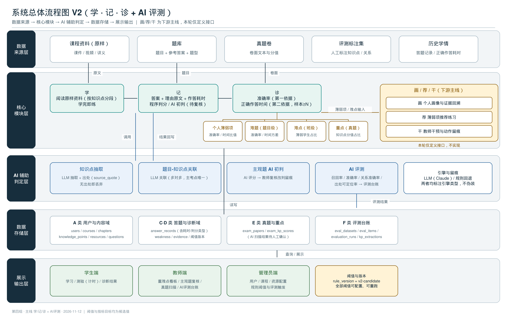

# 智能软件工程学习平台（Smart Learning Platform）

一个面向本科《智能软件工程》课程的三端学习平台演示：学生端 / 教师端 / 管理端。
围绕 **学 → 记 → 诊 → 画 → 荐 → 干** 的学习闭环，重点实现「学、记、诊 + AI 评测」，并按模块契约接入 E5 知识图谱、E4 难点发现与画/荐/干。

> 本项目为课程作品，前端为可独立运行的演示版（Mock API + localStorage），不含真实后端与账号体系。

## 功能概览

### 学生端
- 课程学习：课程结构、课件、视频、单元测验（逐题计时、学完即练提示）
- 诊断结果：准确率第一依据 + 正确作答时间第二依据；证据不足为独立状态
- **自主标识薄弱知识点**：学生可主动标记/取消，并在诊断页与系统判定对比（一致/冲突）
- 个人画像（画）：DifficultyMark 五字段、证据深链、证据缺失灰条、禁用词约束
- 学习推荐（荐）：按薄弱点推练习，800ms 超时降级为 next_check
- 学习记录（干）：回原题 / 去练习 / 问老师，只写动作日志
- AI 助教、知识图谱、行为记录

### 教师端
- 学情看板；重难点诊断（难题 / 难点 / 重点 + 学生自评汇总）
- 主观题复核：AI 初判 → 教师改判，留痕并重算诊断
- 难点标记审核（E4）：五字段 + 证据链，确认/驳回、调整权重
- 课程管理、课件与资料上传、图谱构建（E5）、文本标注、真题扫描、AI 评测台账

### 管理端
- 系统概览、用户/课程/资源/题目管理、阈值配置、日志、AI 模型、CI/CD、备份、安全

## 架构

分层：数据来源 → 学/记/诊 → AI 辅助（E5/E4）→ 数据存储 → 展示输出（画/荐/干）。



## 快速开始

```bash
cd frontend
python3 -m http.server 5200
# 打开 http://127.0.0.1:5200/
```

也可以直接打开 `frontend/index.html`。

演示账号（演示模式，无密码）：

| 端 | 账号 | 说明 |
|---|---|---|
| 学生 | s1 / s2 / s3 | s1 薄弱（准确率）、s2 薄弱（时间）、s3 已掌握 |
| 教师 | t1 / t2 | — |
| 管理员 | a1 | — |

快捷入口：`student.html?auto=1`、`teacher.html?auto=1`、`admin.html?auto=1` 自动登录第一个账号。

## 目录结构

```
frontend/                 三端页面（原生 HTML/CSS/JS）
  index.html              门户
  student.html teacher.html admin.html
  css/app.css
  js/mockdb.js            演示数据（localStorage 持久化）
  js/api.js               Mock API（按接口文档实现）
  js/common.js            布局、登录、通用组件
  js/student.js teacher.js admin.js
docs/design/              系统设计、接口设计、数据库 DDL、设计图
docs/testing/             测试计划、测试报告大纲
```

## 核心设计

- **诊**：准确率 < 60% 判薄弱（第一依据）；准确率达标但「正确作答均时 / 班级均时 > 1.5」且样本 ≥ N 判薄弱（第二依据）；无记录/样本不足为「证据不足」，不判掌握差。
- **自主标识**：独立表 `self_weak_marks`，不参与系统判定，只作展示与推荐优先级。
- **E4**：输出 DifficultyMark 五字段（observation / evidence / uncertainty / next_check / status），教师审核后回写图谱。
- **画/荐/干**：只读消费标记；推荐同步 800ms 硬超时并降级；动作日志只写不干预。
- 所有阈值均为**候选值**（`rule_version = v2-candidate`），可在管理端调整。

## 文档

- [系统设计文档](docs/design/系统设计文档.md)
- [前后端接口设计](docs/design/前后端接口设计.md)
- [数据库 DDL（基线 + 增量）](docs/design/db/)
- [测试计划](docs/testing/测试计划.md) ｜ [测试报告大纲](docs/testing/测试报告大纲.md)

## 声明

- 前端为演示版：数据保存在浏览器 localStorage，接入真实后端时替换 `js/api.js` 即可。
- 演示数据（答题耗时、真题分值、E4 标记、推荐结果）为构造数据，不代表真实学情或模型效果。
- 当前不含登录鉴权、真实文件存储与生产部署配置。
- 课程作品，仅供学习交流。
